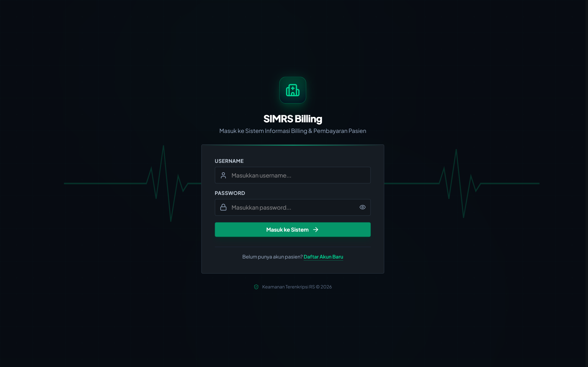
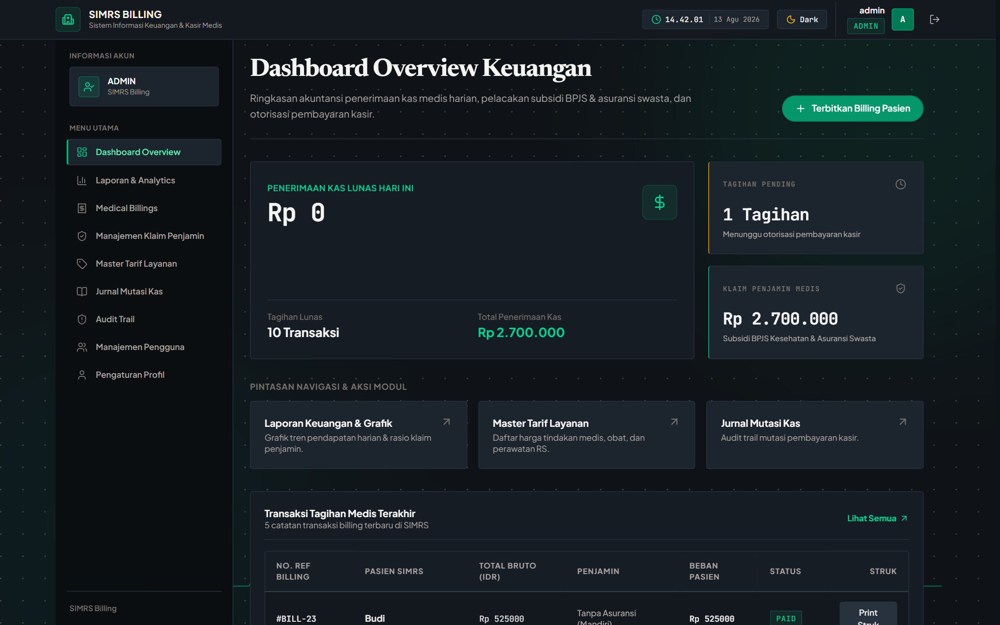
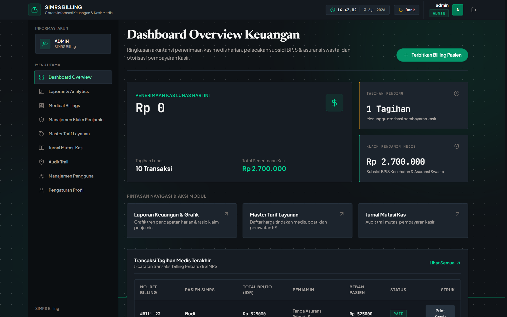
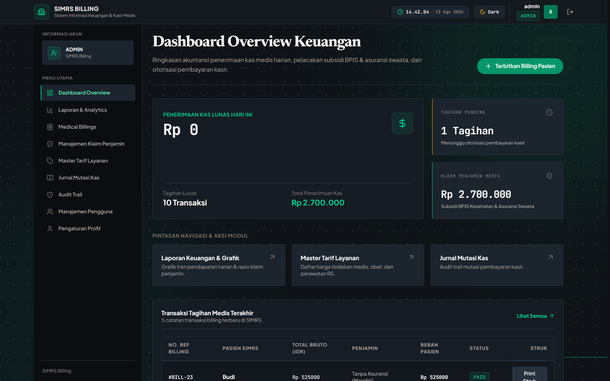
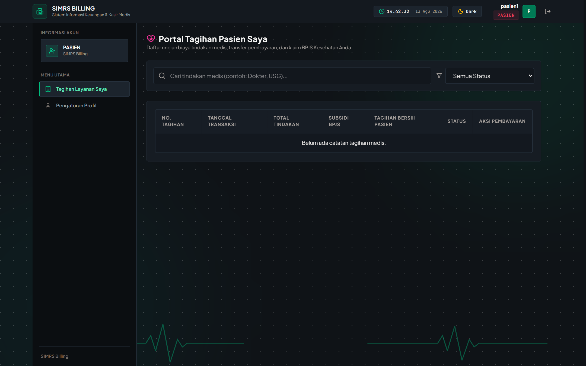
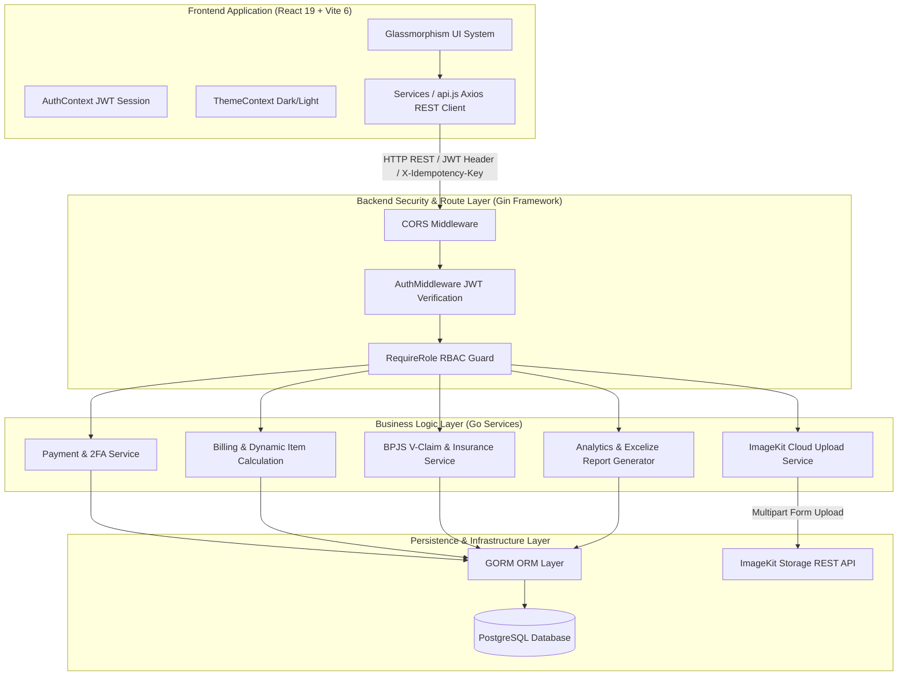
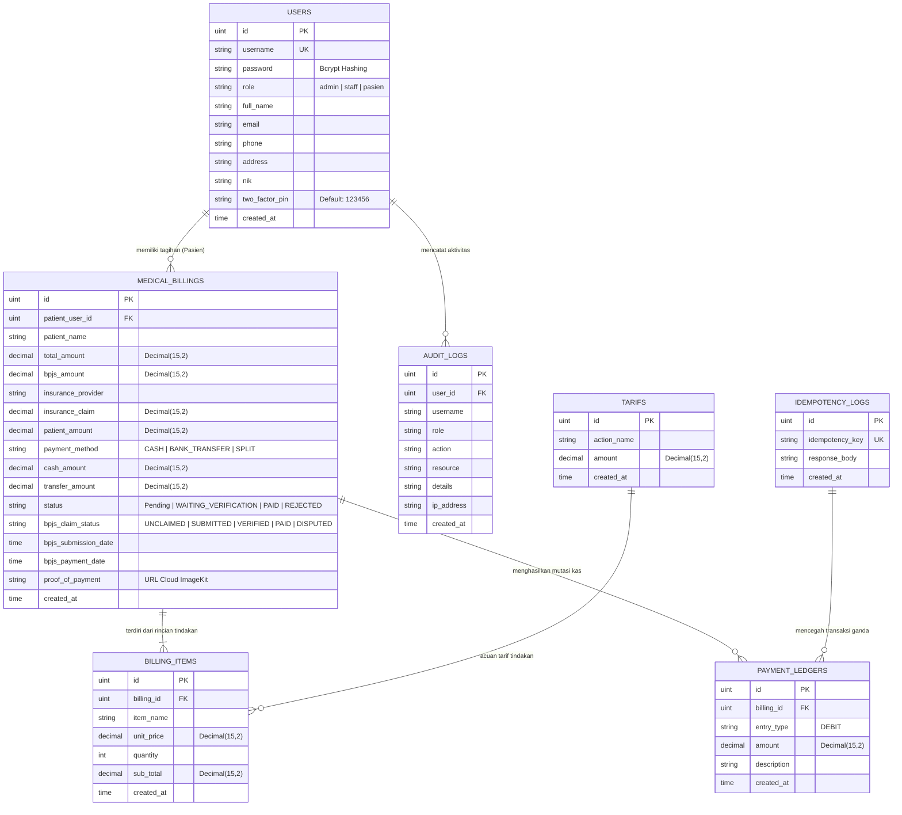

# SIMRS Billing — Sistem Informasi Manajemen Rumah Sakit 🏥💳

Sistem Informasi Manajemen Rumah Sakit (SIMRS) - **Modul Billing, Otorisasi Kasir 2FA, Manajemen Klaim Penjamin (BPJS & Swasta), Portal Mandiri Pasien, & Analytics Keuangan Medis**.

Aplikasi ini dikembangkan sebagai solusi *Full-Stack Enterprise Monorepo* berbasis **Backend Go (Golang)** yang cepat dan aman, dipadukan dengan **Frontend React 19 + Vite 6** bermodel antarmuka *High-Aesthetic Glassmorphism UI*.

---

## 📋 Daftar Isi

- [📸 Galeri Antarmuka & Showcase UI](#-galeri-antarmuka--showcase-ui)
- [🌟 Gambaran Umum Sistem](#-gambaran-umum-sistem)
- [🏛️ Arsitektur Sistem & Diagram Mermaid](#-arsitektur-sistem--diagram-mermaid)
  - [1. Diagram Arsitektur Full-Stack Flowchart](#1-diagram-arsitektur-full-stack-flowchart)
  - [2. Diagram Relasi Entitas Database (ERD)](#2-diagram-relasi-entitas-database-erd)
- [🚀 Fitur Utama & Modul Unggulan](#-fitur-utama--modul-unggulan)
- [🔐 Manajemen Hak Akses (RBAC)](#-manajemen-hak-akses-rbac)
- [🛠️ Stack Teknologi & Dependensi](#-stack-teknologi--dependensi)
- [📂 Struktur Monorepo Proyek](#-struktur-monorepo-proyek)
- [⚡ Panduan Memulai Cepat (Quick Start Guide)](#-panduan-memulai-cepat-quick-start-guide)
- [🔗 Dokumentasi Sub-Modul Terpisah](#-dokumentasi-sub-modul-terpisah)

---

## 📸 Galeri Antarmuka & Showcase UI

Berikut adalah tampilan nyata antarmuka web sistem **SIMRS Billing**:

### 1. Halaman Login (`frontend/ss/01-login-page.png`)
*Antarmuka masuk akun dengan Glassmorphism UI System, Dual Theme Switcher (Dark/Light Mode), dan animasi Ambient Canvas Background.*



---

### 2. Executive Dashboard Overview (`frontend/ss/02-dashboard-overview.png`)
*Dashboard utama yang memberikan ringkasan KPI keuangan rumah sakit, indikator piutang penjamin, statistik penerbitan tagihan, dan transaksi terbaru.*


---

### 3. Transaksi Billing Medis (`frontend/ss/03-billings-management.png`)
*Modul utama pengelolaan tagihan pasien, filter status otorisasi (PENDING/PAID), kalkulasi beban netto pasien vs klaim penjamin, serta aksi kasir.*



---

### 4. Modal Penerbitan Tagihan Medis (`frontend/ss/04-create-billing-modal.png`)
*Form interaktif pembuatan tagihan baru dengan pencarian akun pasien terdaftar (Auto-fill Nama Lengkap ➔ Username), pemilihan tindakan medis dinamis, dan perhitungan rasio klaim.*



---

### 5. Otorisasi Pembayaran Kasir 2FA (`frontend/ss/05-pay-billing-modal.png`)
*Otorisasi pembayaran kasir terlindungi 2FA 6-digit Security PIN, pilihan metode pembayaran (CASH, BANK_TRANSFER, SPLIT), dan proteksi header HTTP `X-Idempotency-Key`.*



---

### 6. Manajemen Klaim BPJS & Asuransi Swasta (`frontend/ss/06-claims-management.png`)
*Pusat pengelolaan klaim subsidi penjamin terpisah antara **🛡️ BPJS Kesehatan (V-Claim)** dan **🏢 Asuransi Swasta** (AXA, Prudential, Allianz, Manulife, FWD, dll.).*


---

### 7. Laporan Keuangan & Analytics (`frontend/ss/07-analytics-dashboard.png`)
*Visualisasi grafik tren pendapatan bulanan, breakdown klaim penjamin, serta fitur pengunduhan laporan kas berformat Excel (.xlsx) & CSV UTF-8 BOM.*


---

### 8. Master Tarif Layanan Medis (`frontend/ss/08-tarifs-master.png`)
*Pengelolaan katalog tarif tindakan medis rumah sakit dengan dukungan operasi CRUD lengkap dan validasi harga.*


---

### 9. System Audit Log & Trail (`frontend/ss/09-audit-logs.png`)
*Monitoring rekam jejak aktivitas pengguna secara real-time yang mencatat Action, Resource, IP Address, Timestamp, dan Detail Perubahan.*


---

### 10. Portal Mandiri Pasien (`frontend/ss/10-patient-portal.png`)
*Portal mandiri bagi pasien terdaftar untuk meninjau rincian tagihan pribadi, melihat struk resmi SIMRS, dan mengunggah bukti transfer bank langsung ke ImageKit Cloud.*



---

## 🌟 Gambaran Umum Sistem

**SIMRS Billing** dirancang untuk mengatasi kompleksitas pengelolaan keuangan rumah sakit modern, mencakup:
- Transaksi pembayaran medis pasien yang terintegrasi dengan berbagai skema penjamin (BPJS Kesehatan & Asuransi Swasta).
- Pencegahan kesalahan transaksi ganda (*double charge*) melalui arsitektur pembayaran idempoten (*Idempotent Payment Architecture*).
- Otorisasi berlapis kasir dengan **2-Factor Authentication (2FA PIN)** dan pencatatan audit log permanen.
- Portal mandiri pasien yang mendukung pengunggahan struk pembayaran langsung ke cloud storage **ImageKit API**.
- Generator analytics eksekutif dan laporan kas bulanan siap unduh dalam format Excel (`.xlsx`) dan CSV.

---

## 🏛️ Arsitektur Sistem & Diagram Mermaid

### 1. Diagram Arsitektur Full-Stack Flowchart



---

### 2. Diagram Relasi Entitas Database (ERD)



---

## 🚀 Fitur Utama & Modul Unggulan

1. **Precision Financial Math (`shopspring/decimal`)**:
   Seluruh kalkulasi nominal uang menggunakan matematika presisi desimal tanpa potensi kesalahan pembulatan *floating point*.
2. **Idempotent Payment Protection (`X-Idempotency-Key`)**:
   Setiap transaksi otorisasi bayar diproteksi dengan *Idempotency Log* pada database untuk menangkal pemrosesan ganda akibat *network retry* atau klaim berulang.
3. **2-Factor Authentication (2FA PIN Kasir)**:
   Transaksi otorisasi bayar wajib menyertakan header `X-2FA-Code` yang mencocokkan PIN 6-digit keamanan akun kasir.
4. **Integration Cloud Storage ImageKit**:
   Unggah struk/bukti bayar pasien diproses otomatis ke ImageKit Cloud Storage via HTTP multipart request.
5. **Klaim BPJS V-Claim & Asuransi Swasta**:
   Pengelolaan klaim penjamin terpisah dengan indikator status: `UNCLAIMED` ➔ `SUBMITTED` ➔ `VERIFIED` ➔ `PAID` / `DISPUTED`.
6. **Laporan & Analytics Keuangan Multi-Format**:
   Visualisasi grafik tren bulanan dan fitur unduh laporan kas berformat Excel (`.xlsx`) serta CSV (UTF-8 BOM).
7. **Jurnal Mutasi Kas & Audit Trail System**:
   Pencatatan mutasi kas masuk permanen (*immutable payment journal*) serta audit trail log transparan.
8. **Struk Pembayaran Medis Siap Print (`ReceiptModal.jsx`)**:
   Format struk rincian tindakan medis SIMRS resmi yang dapat dicetak langsung via browser.

---

## 🔐 Manajemen Hak Akses (RBAC)

Aplikasi menerapkan **Role-Based Access Control (RBAC)** ketat yang membagi hak akses ke dalam 3 peranan utama:

| Peran (Role) | Hak Akses & Fitur Utama |
| :--- | :--- |
| **Admin** | **Akses Penuh Seluruh Modul**: User Management (`/users`), Delete Ledger Mutasi Kas, Create/Pay Billing, Master Tarif, Claims Management, Analytics Export, dan Audit Log. |
| **Staff / Kasir** | **Operasional Kasir & Keuangan**: Create Billing, Otorisasi Bayar 2FA (`/billings`), Penolakan Bukti Transfer, Master Tarif, Claims BPJS/Swasta, Analytics Export, dan Audit Log. *(Tidak dapat menghapus User & Ledger Mutasi Kas)*. |
| **Pasien** | **Portal Mandiri Pasien**: Peninjauan riwayat tagihan medis pribadi (`/my-billings`), pencetakan struk pembayaran, dan pengunggahan bukti transfer bank ke ImageKit Cloud. |

---

## 🛠️ Stack Teknologi & Dependensi

### Backend Stack (`server/`)
* **Bahasa**: Go (Golang) v1.26+
* **Framework**: Gin Gonic (`github.com/gin-gonic/gin`)
* **ORM & DB**: GORM ORM (`gorm.io/gorm`) & PostgreSQL
* **Keamanan**: JWT (`golang-jwt/jwt/v5`) & Bcrypt Password Hashing (`x/crypto/bcrypt`)
* **Matematika Keuangan**: `github.com/shopspring/decimal`
* **Cloud Storage**: ImageKit REST API via HTTP client
* **Ekspor Excel**: `github.com/xuri/excelize/v2`

### Frontend Stack (`frontend/`)
* **Framework Core**: React 19 + Vite 6
* **Styling**: Tailwind CSS + CSS Custom Variables (`index.css`)
* **Iconography**: Lucide React Icons (`lucide-react`)
* **State & Context**: AuthContext (Session & RBAC Rules) + ThemeContext (Dark/Light Switcher)
* **Media Upload**: Multipart Form-Data Request ke ImageKit API

---

## 📂 Struktur Monorepo Proyek

```text
simrs-billing/
├── frontend/                # Sub-modul Frontend (React 19 + Vite 6)
│   ├── ss/                  # Dokumentasi screenshot antarmuka web (10 Gambar)
│   ├── public/              # Aset statis publik
│   ├── src/
│   │   ├── components/      # Komponen UI reusable (Modal, Receipt, 2FA, Toast, dll.)
│   │   ├── context/         # AuthContext & ThemeContext
│   │   ├── pages/           # Halaman Aplikasi (Dashboard, Billings, Claims, Analytics, dll.)
│   │   └── services/        # Client API Rest Backend (`api.js`)
│   ├── README.md            # Dokumentasi Detail Frontend
│   ├── package.json         # Dependensi npm
│   └── vite.config.js       # Konfigurasi Vite & Dev Proxy
├── server/                  # Sub-modul Backend REST API (Go / Gin Framework)
│   ├── cmd/seed/            # CLI Seeder Standalone
│   ├── config/              # Inisialisasi PostgreSQL DB & GORM
│   ├── handlers/            # Controller HTTP Presentation Layer
│   ├── middleware/          # JWT Verification & RequireRole RBAC Guard
│   ├── models/              # Struct Schema Database PostgreSQL
│   ├── repository/          # Data Access Layer GORM
│   ├── route/               # Routing Group REST API
│   ├── seeders/             # Initial Data Seeder User & Tarif
│   ├── services/            # Business Logic Layer
│   ├── utils/               # Helper JWT, Password, Pagination
│   ├── .env                 # Variabel Konfigurasi Environment
│   ├── go.mod               # Dependencies Manager Go
│   ├── main.go              # Entry Point Server & Flag Parser (-seed)
│   └── README.md            # Dokumentasi Detail Backend API
├── README.md                # Dokumentasi Utama Root Monorepo SIMRS Billing
└── graphify-out/            # Knowledge Graph Architecture Project
```

---

## ⚡ Panduan Memulai Cepat (Quick Start Guide)

### 1. Prasyarat Sistem
- **Go**: v1.26+
- **Node.js**: v18.0.0 atau v20.0.0+
- **PostgreSQL**: Terpasang dan aktif di port `5432`

---

### 2. Konfigurasi & Jalankan Backend Server (`server/`)

1. **Buka terminal dan masuk ke folder `server/`**:
   ```bash
   cd server
   ```

2. **Buat file `.env`**:
   ```env
   PORT=8080
   DB_HOST=localhost
   DB_USER=postgres
   DB_PASSWORD=postgres
   DB_NAME=simrs_billing
   DB_PORT=5432
   JWT_SECRET=supersecretkey_simrs_2026

   IMAGEKIT_PUBLIC_KEY="your_imagekit_public_key"
   IMAGEKIT_URL_ENDPOINT="https://ik.imagekit.io/your_imagekit_id"
   IMAGEKIT_PRIVATE_KEY="your_imagekit_private_key"
   ```

3. **Install dependensi Go & jalankan server sekaligus Seeding Data**:
   ```bash
   go run main.go -seed
   ```
   *Backend REST API akan aktif di `http://localhost:8080`.*

---

### 3. Konfigurasi & Jalankan Frontend Web (`frontend/`)

1. **Buka terminal baru dan masuk ke folder `frontend/`**:
   ```bash
   cd frontend
   ```

2. **Install dependensi npm**:
   ```bash
   npm install
   ```

3. **Jalankan server mode development**:
   ```bash
   npm run dev
   ```
   *Aplikasi web akan aktif di `http://localhost:5173`.*

---

### 🔑 Kredensial Default Login Awal:

| Peran (Role) | Username | Password | Security PIN 2FA |
| :--- | :--- | :--- | :--- |
| **Admin** | `admin` | `password123` | `123456` |
| **Staff Kasir** | `staff` | `password123` | `123456` |
| **Pasien 1** | `pasien1` | `password123` | — |
| **Pasien 2** | `pasien2` | `password123` | — |

---

## 🔗 Dokumentasi Sub-Modul Terpisah

Untuk penjelasan teknis lebih mendalam mengenai masing-masing bagian aplikasi, silakan merujuk ke dokumentasi sub-modul berikut:

- 📘 [**Dokumentasi Detail Backend REST API (`server/README.md`)**](file:///d:/Documents/1_Project_Magang/simrs-billing/server/README.md) — Mengulas spesifikasi 28+ API Endpoint, diagram ERD, Sequence Diagram Idempotensi, dan konfigurasi database.
- 💻 [**Dokumentasi Detail Frontend Application (`frontend/README.md`)**](file:///d:/Documents/1_Project_Magang/simrs-billing/frontend/README.md) — Mengulas galeri antarmuka UI, komponen React, arsitektur `api.js`, dan manajemen state tema & autentikasi.
