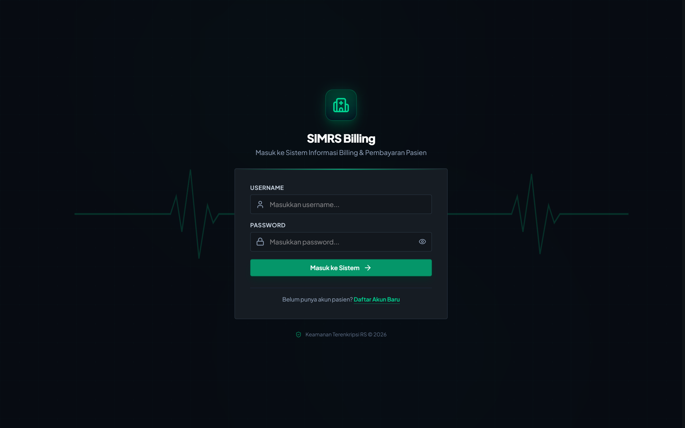
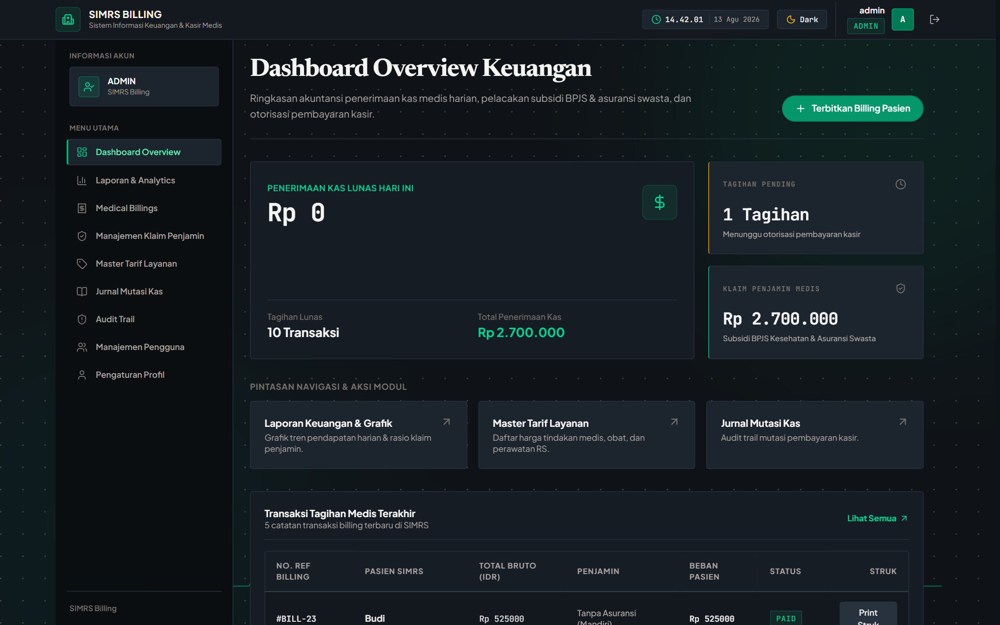
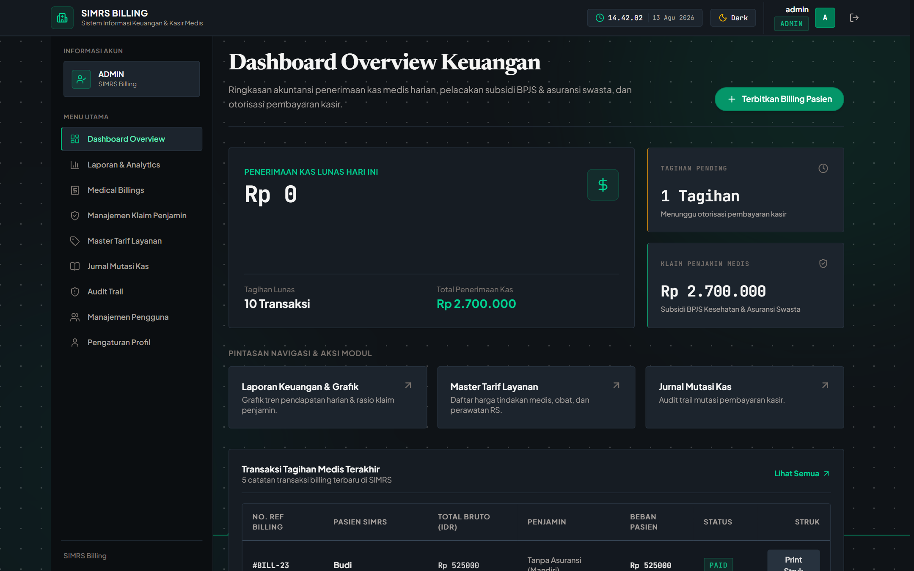
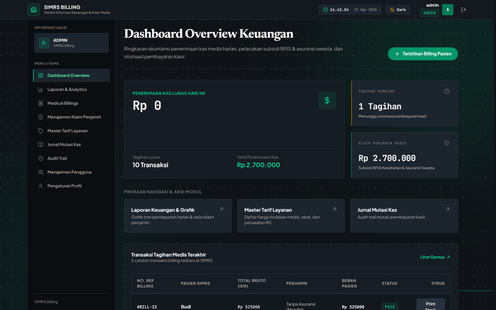
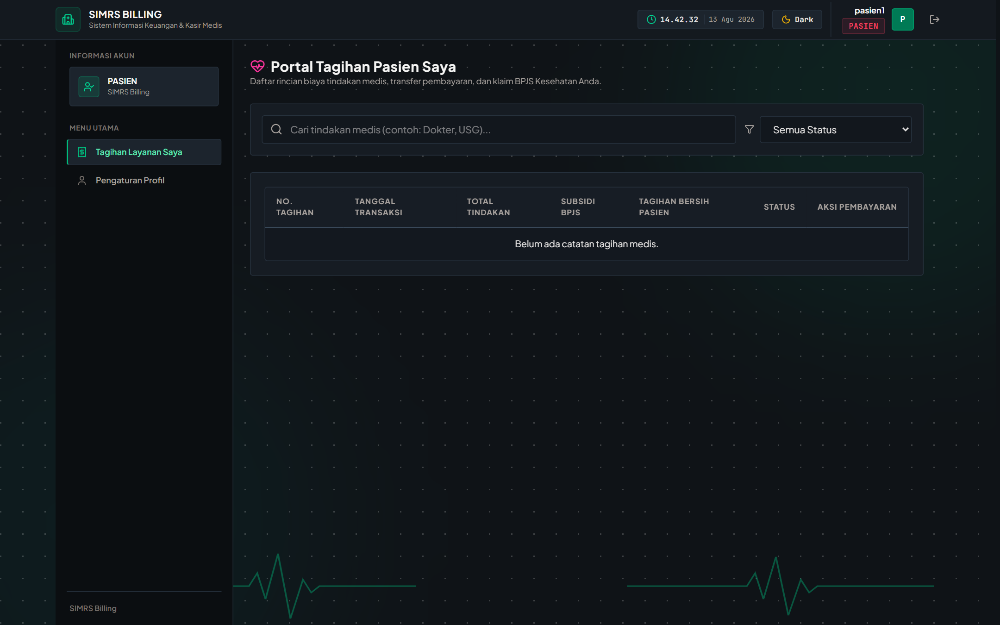

# SIMRS Billing Frontend Application 🏥💻

Aplikasi Antarmuka Web Modern untuk **Sistem Informasi Manajemen Rumah Sakit (SIMRS) - Modul Billing, Otorisasi Kasir, Verifikasi Klaim Penjamin, & Analytics Keuangan Medis**. 

Built with **React 19**, **Vite 6**, **Tailwind CSS**, **Glassmorphism UI System**, **Lucide Icons**, dan **ImageKit Cloud Storage**.

---

## 📋 Daftar Isi

- [📸 Galeri Antarmuka & Tangkapan Layar (UI Showcase)](#-galeri-antarmuka--tangkapan-layar-ui-showcase)
- [🚀 Fitur Utama](#-fitur-utama)
- [🔐 Manajemen Hak Akses (RBAC)](#-manajemen-hak-akses-rbac)
- [🛠️ Teknologi & Dependensi](#-teknologi--dependensi)
- [📂 Struktur Proyek](#-struktur-proyek)
- [🖥️ Detail Halaman & Modul UI](#-detail-halaman--modul-ui)
- [🧩 Detail Komponen UI Reusable](#-detail-komponen-ui-reusable)
- [🔗 Arsitektur Integrasi API Backend (`api.js`)](#-arsitektur-integrasi-api-backend-apijs)
- [⚡ Panduan Memulai & Deployment](#-panduan-memulai--deployment)

---

## 📸 Galeri Antarmuka & Tangkapan Layar (UI Showcase)

Tampilan antarmuka nyata dari sistem **SIMRS Billing** yang disimpan di dalam direktori `ss/`:

### 1. Halaman Login (`ss/01-login-page.png`)
*Antarmuka autentikasi pengguna dengan estetika High-Aesthetic Glassmorphism, efek animasi ambient background canvas, dan switcher mode gelap/terang.*



---

### 2. Dashboard Overview (`ss/02-dashboard-overview.png`)
*Ringkasan eksekutif transaksi SIMRS yang menampilkan kartu statistik KPI utama, ringkasan penerbitan billing, piutang klaim, dan aktivitas terbaru.*


---

### 3. Manajemen Billing Medis (`ss/03-billings-management.png`)
*Modul utama pengelolaan tagihan pasien, filter status otorisasi (PENDING/PAID), kalkulasi beban netto pasien vs penjamin, serta aksi otorisasi kasir.*



---

### 4. Modal Penerbitan Tagihan Medis (`ss/04-create-billing-modal.png`)
*Form interaktif penerbitan billing baru dengan pencarian akun pasien terdaftar (Auto-fill Nama Lengkap ➔ Username), pemilihan tindakan medis dinamis, dan kalkulasi rasio penjamin.*



---

### 5. Modal Otorisasi Bayar & 2FA Kasir (`ss/05-pay-billing-modal.png`)
*Otorisasi pembayaran kasir terlindungi 2FA 6-digit PIN, pilihan metode pembayaran fleksibel (CASH, BANK_TRANSFER, SPLIT), serta proteksi header HTTP `X-Idempotency-Key`.*



---

### 6. Manajemen Klaim Penjamin (`ss/06-claims-management.png`)
*Pusat pengelolaan klaim subsidi penjamin medis terpisah antara **🛡️ BPJS Kesehatan (V-Claim)** dan **🏢 Asuransi Swasta** (AXA, Prudential, Allianz, Manulife, dll.).*


---

### 7. Laporan Keuangan & Analytics (`ss/07-analytics-dashboard.png`)
*Visualisasi grafik tren pendapatan bulanan, breakdown klaim penjamin, indikator rasio keuangan, serta pengunduhan laporan kas berformat Excel (.xlsx) & CSV.*


---

### 8. Master Tarif Layanan Medis (`ss/08-tarifs-master.png`)
*Pengelolaan katalog tarif tindakan medis rumah sakit dengan dukungan CRUD lengkap dan validasi harga.*


---

### 9. Audit Log & System Trail (`ss/09-audit-logs.png`)
*Monitoring jejak audit aktivitas pengguna secara real-time yang mencatat Action, Resource, IP Address, Timestamp, dan Perubahan State.*


---

### 10. Portal Mandiri Pasien (`ss/10-patient-portal.png`)
*Portal mandiri bagi pasien terdaftar untuk meninjau rincian tagihan pribadi, melihat struk resmi, dan mengunggah bukti transfer bank langsung ke ImageKit Cloud.*



---

## 🚀 Fitur Utama

1. **Modern Glassmorphism UI & Dual Theme System**:
   - Tampilan antarmuka berestetika tinggi (*High-Aesthetic Glassmorphism*) dengan dukungan **Mode Gelap (Dark Mode)** dan **Mode Terang (Light Mode)**.
   - Dilengkapi kanvas animasi ambient background (`AmbientBackground.jsx`).

2. **Penerbitan Tagihan Medis Dynamic (`CreateBillingModal`)**:
   - Pencarian akun pasien terdaftar dengan **Prioritas Auto-fill Nama Lengkap (`full_name`) ➔ Username**.
   - Pemilihan tindakan/tarif medis dinamis dengan kalkulasi kuantitas item per tindakan.
   - Perhitungan otomatis Total Bruto, Klaim Penjamin/Asuransi, dan Beban Netto Pasien (`patient_amount`).
   - Pencetakan **Struk Rincian Pembayaran Medis Resmi** siap print (`ReceiptModal.jsx`).

3. **Otorisasi Kasir & Keamanan 2FA PIN (`TwoFactorModal`)**:
   - Penginputan metode pembayaran fleksibel (`CASH`, `BANK_TRANSFER`, dan `SPLIT`).
   - Verifikasi PIN 6-digit 2-Factor Authentication (2FA) kasir via header HTTP `X-2FA-Code`.
   - Header HTTP `X-Idempotency-Key` otomatis untuk mencegah double charge / transaksi ganda.

4. **Manajemen Klaim Penjamin Terpisah (`ClaimsPage`)**:
   - Navigasi **Tab Terpisah** untuk 🛡️ **Klaim BPJS Kesehatan (V-Claim)** dan 🏢 **Klaim Asuransi Swasta** (AXA, Prudential, Allianz, Manulife, FWD, dll.).
   - Pelacakan status klaim secara real-time (`UNCLAIMED`, `SUBMITTED`, `VERIFIED`, `PAID`, `DISPUTED`).
   - Kartu KPI ringkasan piutang klaim dinamis yang menyesuaikan dengan Tab penjamin aktif.

5. **Portal Mandiri Pasien & ImageKit Cloud Upload (`MyBillingsPage`)**:
   - Pasien dapat melihat riwayat tagihan medis pribadi, rincian tindakan, dan beban netto.
   - Pengunggahan struk/bukti transfer bank langsung ke cloud storage ImageKit API yang otomatis memperbarui status tagihan menjadi `WAITING_VERIFICATION`.

6. **Laporan & Analytics Keuangan Interaktif (`AnalyticsDashboard`)**:
   - Visualisasi grafik trend pendapatan bulanan (`RevenueTrendChart.jsx`), rasio klaim penjamin vs bayar pasien, dan kartu KPI indikator keuangan (`FinancialKpiCards.jsx`).
   - Pengunduhan laporan kas bulanan langsung dalam format Excel (`.xlsx`) dan CSV (dengan UTF-8 BOM).

7. **Jurnal Mutasi Kas & Audit Trail System**:
   - Peninjauan mutasi kas masuk secara permanen (*Payment Ledgers*) serta pemantauan log jejak aktivitas pengguna secara transparan (*Audit Log Page*).

---

## 🔐 Manajemen Hak Akses (RBAC)

Sistem menyesuaikan visibilitas navigasi Sidebar dan izin interaksi tombol sesuai dengan *Role* pengguna terautentikasi:

| Peran (Role) | Akses Halaman & Fitur UI |
| :--- | :--- |
| **Admin** | Akses penuh ke seluruh modul: User Management (`/users`), Delete Ledger, Create/Pay Billing, Master Tarif, Claims, Analytics, Audit Log. |
| **Staff / Kasir** | Create Billing, Pay Billing (2FA), Reject Proof, Master Tarif, Claims BPJS/Swasta, Analytics Export, Audit Log. *(Tidak dapat hapus Ledger & User Management)*. |
| **Pasien** | Portal Pasien (`/my-billings`): Melihat tagihan pribadi, melihat struk rincian, dan upload bukti bayar bank ke ImageKit Cloud. |

---

## 🛠️ Teknologi & Dependensi

- **Framework Core**: [React 19](https://react.dev/) + [Vite 6](https://vitejs.dev/)
- **Styling & Design System**: Tailwind CSS + CSS Custom Properties / Design Tokens (`index.css`)
- **Iconography**: [Lucide React](https://lucide.dev/)
- **State Management & Context**:
  - `AuthContext.jsx`: Session user, JWT token persistence, dan kualifikasi RBAC.
  - `ThemeContext.jsx`: Dark Mode / Light Mode switcher dengan LocalStorage sync.
- **Media Upload**: Multipart Form-Data Request ke ImageKit API Cloud Storage.
- **File Export Handler**: Integration File System Access API (`window.showSaveFilePicker`) & Anchor Blob Fallback.

---

## 📂 Struktur Proyek

```text
frontend/
├── ss/                      # Screenshots dokumentasi antarmuka web (10 gambar)
│   ├── 01-login-page.png
│   ├── 02-dashboard-overview.png
│   ├── 03-billings-management.png
│   ├── 04-create-billing-modal.png
│   ├── 05-pay-billing-modal.png
│   ├── 06-claims-management.png
│   ├── 07-analytics-dashboard.png
│   ├── 08-tarifs-master.png
│   ├── 09-audit-logs.png
│   └── 10-patient-portal.png
├── public/                  # Asset statis publik (logo, favicon)
├── src/
│   ├── components/
│   │   ├── analytics/
│   │   │   ├── FinancialKpiCards.jsx # Kartu KPI analitik keuangan
│   │   │   └── RevenueTrendChart.jsx # Grafik tren pendapatan bulanan
│   │   ├── billings/
│   │   │   ├── CreateBillingModal.jsx # Modal buat tagihan medis baru
│   │   │   └── PayBillingModal.jsx    # Modal otorisasi bayar & split payment
│   │   ├── layout/
│   │   │   ├── Navbar.jsx   # Topbar navigasi, toggle theme, & profil user
│   │   │   └── Sidebar.jsx  # Menu navigasi samping berbasis Role (RBAC)
│   │   └── ui/
│   │       ├── AmbientBackground.jsx # Background kanvas animasi ambient
│   │       ├── Badge.jsx    # Badges status (PAID, PENDING, REJECTED, dll.)
│   │       ├── Modal.jsx    # Reusable Glassmorphism Modal container
│   │       ├── Pagination.jsx # Navigasi kontrol halaman data
│   │       ├── ReceiptModal.jsx # Struk pembayaran resmi SIMRS (Siap Print)
│   │       ├── StatCard.jsx   # Kartu statistik ringkasan dashboard
│   │       ├── Toast.jsx      # Notifikasi toast melayang (Success/Error)
│   │       └── TwoFactorModal.jsx # Modal verifikasi PIN 2FA Kasir
│   ├── context/
│   │   ├── AuthContext.jsx  # Context JWT Session, User Data, & Role Rules
│   │   └── ThemeContext.jsx # Context Tema (Dark Mode / Light Mode)
│   ├── pages/
│   │   ├── AnalyticsDashboard.jsx # Laporan grafik & ekspor Excel/CSV
│   │   ├── AuditLogPage.jsx       # Monitoring audit log aktivitas pengguna
│   │   ├── BillingsPage.jsx       # Manajemen billing medis & kasir
│   │   ├── ClaimsPage.jsx         # Tab klaim BPJS V-Claim & Asuransi Swasta
│   │   ├── Dashboard.jsx          # Dashboard ringkasan overview SIMRS
│   │   ├── LedgersPage.jsx        # Jurnal mutasi kas masuk
│   │   ├── Login.jsx              # Halaman masuk akun
│   │   ├── MyBillingsPage.jsx     # Portal Pasien (Tagihan Saya & Upload Proof)
│   │   ├── ProfilePage.jsx        # Pengaturan profil & update PIN 2FA
│   │   ├── Register.jsx           # Form pendaftaran akun pasien baru
│   │   ├── TarifsPage.jsx         # Master data tarif layanan medis
│   │   └── UsersPage.jsx          # User Management (Khusus Admin)
│   ├── services/
│   │   └── api.js                 # Centralized Backend REST Client Services
│   ├── App.css                    # Utility style overrides
│   ├── App.jsx                    # Routing per role & layout wrapper
│   ├── index.css                  # Core CSS variables, Glassmorphism tokens
│   └── main.jsx                   # Mount point utama React 19
├── .oxlintrc.json                 # Linter configuration (Oxlint)
├── index.html                     # HTML5 Template Root
├── package.json                   # Manifest dependensi & npm scripts
└── vite.config.js                 # Vite bundler & development proxy config
```

---

## 🖥️ Detail Halaman & Modul UI

1. **Dashboard Overview (`/`)**: Menampilkan statistik ringkasan total penerbitan tagihan, piutang klaim penjamin, transaksi kasir terbaru, dan navigasi cepat.
2. **Transaksi Billing Medis (`/billings`)**: Form pembuatan billing pasien baru, filter status (`Pending`, `WAITING_VERIFICATION`, `PAID`, `REJECTED`), otorisasi bayar 2FA kasir, penolakan bukti bayar, dan cetak struk.
3. **Manajemen Klaim Penjamin (`/claims`)**: Tab terpisah antara **BPJS Kesehatan (V-Claim)** & **Asuransi Swasta** beserta update status klaim (`UNCLAIMED`, `SUBMITTED`, `VERIFIED`, `PAID`, `DISPUTED`).
4. **Master Tarif Layanan (`/tarifs`)**: Tabel harga tindakan medis dengan fitur penambahan, pembaruan, dan penghapusan tarif.
5. **Portal Pasien (`/my-billings`)**: Riwayat tagihan medis pribadi milik pasien yang sedang login beserta modal upload file bukti bayar bank.
6. **Laporan Keuangan & Analytics (`/analytics`)**: Dashboard grafik performa pendapatan bulanan, breakdown klaim penjamin, serta tombol ekspor Excel/CSV.
7. **Jurnal Mutasi Kas (`/ledgers`)**: Record mutasi kas masuk hasil otorisasi pembayaran kasir.
8. **Audit Trail System (`/audit-logs`)**: Log rekam jejak aktivitas keamanan seluruh pengguna SIMRS (Action, IP Address, Resource, Detail).
9. **Pengaturan Profil (`/profile`)**: Form update data diri pasien/staff dan pembaruan PIN 6-digit 2FA kasir.
10. **User Management (`/users`)**: Khusus Admin untuk melihat, menambah, mengubah role, dan menghapus akun pengguna SIMRS.

---

## 🧩 Detail Komponen UI Reusable

- **`CreateBillingModal.jsx`**: Form interaktif membuat tagihan medis pasien dengan pencarian user otomatis dan kalkulasi item tindakan.
- **`PayBillingModal.jsx`**: Form input otorisasi pembayaran dengan pilihan metode `CASH`, `BANK_TRANSFER`, atau `SPLIT` payment.
- **`TwoFactorModal.jsx`**: Modal dialog penginputan 6-digit PIN 2FA kasir untuk memverifikasi transaksi pembayaran.
- **`ReceiptModal.jsx`**: Layout struk rincian pembayaran tagihan rumah sakit yang dapat diprint langsung melalui browser.
- **`AmbientBackground.jsx`**: Canvas efek latar belakang berpendar (*ambient visual glow*) yang responsif terhadap pergerakan tema.
- **`Badge.jsx`**: Label indikator status terstandarisasi dengan warna khas (Green untuk PAID, Yellow untuk PENDING, Purple untuk WAITING_VERIFICATION, Red untuk REJECTED).
- **`Pagination.jsx`**: Component navigasi halaman data yang konsisten di seluruh halaman tabel.

---

## 🔗 Arsitektur Integrasi API Backend (`api.js`)

Seluruh komunikasi HTTP ke REST API Backend dikendalikan terpusat melalui `src/services/api.js`:

- **Base URL**: `/api/v1` (Diproxy oleh Vite dev server ke `http://localhost:8080`).
- **Otomatisasi Header Authorization**: Token JWT diambil dari `localStorage.getItem('simrs_token')` dan disisipkan pada setiap request privat.
- **Injeksi Header Keamanan**:
  - `X-Idempotency-Key`: Dihasilkan secara otomatis (`PAY-BILLING-{id}-{timestamp}`) untuk mencegah transaksi ganda.
  - `X-2FA-Code`: Disisipkan saat melakukan otorisasi pembayaran kasir.
- **Unggah Bukti Bayar Multipart**: `billingApi.submitProof()` menggunakan `FormData` untuk mengirimkan berkas gambar ke backend yang akan mengunggahnya ke cloud ImageKit.

---

## ⚡ Panduan Memulai & Deployment

### 1. Prasyarat Sistem
- **Node.js** v18.0.0 atau v20.0.0+
- **NPM** atau **Yarn**

### 2. Install Dependensi
Buka terminal di dalam direktori `frontend/`:

```bash
npm install
```

### 3. Jalankan Server Mode Development
```bash
npm run dev
```
Aplikasi web akan dapat diakses di `http://localhost:5173`.

### 4. Build untuk Production
```bash
npm run build
```
File bundle hasil kompilasi statis akan siap di direktori `dist/`.
