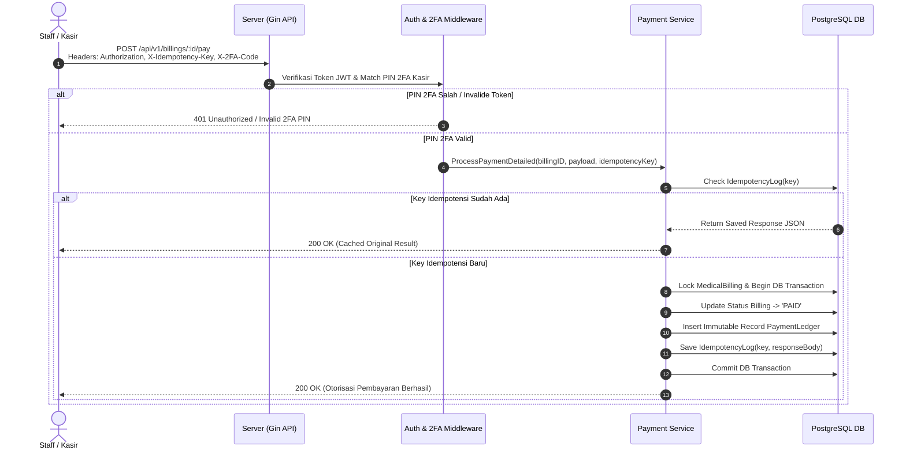
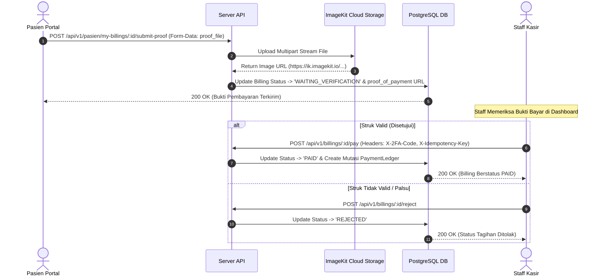

# SIMRS Billing Backend API Documentation 🏥💳

Backend REST API untuk **Sistem Informasi Manajemen Rumah Sakit (SIMRS) - Modul Billing, Otorisasi Pembayaran, & Transaksi Keuangan Medis**. Built using **Go (Golang)**, **Gin Web Framework**, **GORM ORM**, **PostgreSQL**, **ImageKit Cloud**, dan **Decimal Math Precision**.

---

## 📋 Daftar Isi

- [Fitur Utama](#-fitur-utama)
- [Teknologi yang Digunakan](#-teknologi-yang-digunakan)
- [Struktur Proyek (Layered Architecture)](#-struktur-proyek-layered-architecture)
- [Diagram Arsitektur & ERD](#-diagram-arsitektur--erd)
  - [1. Diagram Relasi Entitas Database (ERD)](#1-diagram-relasi-entitas-database-erd)
  - [2. Sequence Diagram: Pembayaran Idempoten Kasir & 2FA](#2-sequence-diagram-pembayaran-idempoten-kasir--2fa)
  - [3. Sequence Diagram: Unggah Bukti Bayar Pasien & Verifikasi Kasir](#3-sequence-diagram-unggah-bukti-bayar-pasien--verifikasi-kasir)
- [Panduan Instalasi & Memulai](#-panduan-instalasi--memulai)
- [Seeding Database Data Awal](#-seeding-database-data-awal)
- [Dokumentasi Lengkap API Endpoint](#-dokumentasi-lengkap-api-endpoint)
  - [1. Autentikasi (Public)](#1-autentikasi-public)
  - [2. Profil Pengguna (Privat - All Roles)](#2-profil-pengguna-privat---all-roles)
  - [3. Master Data Tarif Layanan (Staff / Admin)](#3-master-data-tarif-layanan-staff--admin)
  - [4. Tagihan Medis / Medical Billing (Staff / Admin)](#4-tagihan-medis--medical-billing-staff--admin)
  - [5. Manajemen Klaim BPJS & Asuransi Swasta (Staff / Admin)](#5-manajemen-klaim-bpjs--asuransi-swasta-staff--admin)
  - [6. Manajemen Pengguna / User Management (Staff / Admin)](#6-manajemen-pengguna--user-management-staff--admin)
  - [7. Jurnal Kas & Mutasi Pembayaran (Staff / Admin / Admin Delete)](#7-jurnal-kas--mutasi-pembayaran-staff--admin--admin-delete)
  - [8. Analytics & Ekspor Laporan Keuangan (Staff / Admin)](#8-analytics--ekspor-laporan-keuangan-staff--admin)
  - [9. Audit Trail System (Staff / Admin)](#9-audit-trail-system-staff--admin)
  - [10. Portal Mandiri Pasien (Pasien Only)](#10-portal-mandiri-pasien-pasien-only)
- [Idempotensi & Keamanan Keuangan](#-idempotensi--keamanan-keuangan)

---

## 🚀 Fitur Utama

1. **Role-Based Access Control (RBAC)**: Autentikasi terpusat berbasis JWT dengan 3 hirarki hak akses: `admin`, `staff`, dan `pasien`.
2. **Kalkulasi Presisi Tinggi (Decimal Math)**: Menggunakan pustaka `shopspring/decimal` (bukan floating point biasa) untuk menjamin akurasi perhitungan nominal uang tanpa *rounding error*.
3. **Pembayaran Idempoten (*Idempotent Payment*)**: Dilengkapi perlindungan *double charge/double spending* berbasis header `X-Idempotency-Key` dan pencatatan audit log idempoten di database.
4. **Otorisasi Kasir 2-Factor Authentication (2FA)**: Verifikasi PIN 6-digit kasir/staff via header `X-2FA-Code` pada setiap transaksi otorisasi bayar.
5. **Verifikasi Bukti Transfer & ImageKit Cloud Integration**: Pasien dapat mengunggah struk/bukti transfer bank yang disimpan otomatis ke cloud storage ImageKit API dengan status `WAITING_VERIFICATION`, dilanjutkan otorisasi (`pay`) atau penolakan (`reject`) oleh staff kasir.
6. **Dukungan Pembayaran Multimode**: Mendukung skema pembayaran `CASH`, `BANK_TRANSFER`, maupun `SPLIT` (gabungan tunai dan transfer).
7. **Manajemen Klaim Penjamin Terpisah**: Pemisahan dan filter terintegrasi untuk piutang **BPJS Kesehatan (V-Claim)** dan **Asuransi Swasta** (AXA, Prudential, Allianz, Manulife, FWD, dll.) dengan status workflow: `UNCLAIMED` ➔ `SUBMITTED` ➔ `VERIFIED` ➔ `PAID` / `DISPUTED`.
8. **Ekspor Laporan Keuangan Multi-Format**: Generator laporan keuangan otomatis yang dapat diunduh dalam format Excel (`.xlsx`) dan CSV dengan sertifikasi UTF-8 BOM untuk komparabilitas Microsoft Excel.
9. **Jurnal Mutasi Kas (*Payment Ledger*) & Audit Trail**: Pencatatan mutasi kas masuk secara permanen (*immutable debit entry*) serta log rekam jejak audit keamanan pengguna (*IP address, User Agent, Timestamp, Action*).
10. **Smart Patient Lookup & Pagination**: Fitur pencarian otomatis mengutamakan Nama Lengkap Pasien (`full_name`) sebelum jatuh kembali ke `username`, lengkap dengan kalkulasi pagination presisi.

---

## 🛠️ Teknologi yang Digunakan

* **Bahasa Pemrograman**: Go (Golang) 1.26+
* **Web Framework**: [Gin Gonic](https://github.com/gin-gonic/gin)
* **ORM (Object-Relational Mapping)**: [GORM PostgreSQL Driver](https://gorm.io/)
* **Database Engine**: PostgreSQL
* **Autentikasi & Keamanan**: JWT (`golang-jwt/jwt/v5`) & Bcrypt Hashing (`golang.org/x/crypto`)
* **Pustaka Matematika Keuangan**: `github.com/shopspring/decimal`
* **Cloud Storage Upload**: ImageKit Storage API via multipart HTTP client
* **Ekspor Spreadsheet**: `github.com/xuri/excelize/v2`

---

## 📂 Struktur Proyek (Layered Architecture)

Proyek ini menggunakan arsitektur berlapis yang terdekopel (*Decoupled Architecture*) dengan pemisahan tanggung jawab (*Separation of Concerns*) yang ketat:

```text
server/
├── cmd/
│   └── seed/
│       └── main.go          # Standalone CLI runner untuk seeding database
├── config/
│   └── db.go                # Konfigurasi GORM & AutoMigrate skema PostgreSQL
├── handlers/                # HTTP Controllers (Handling Requests & Reponses)
│   ├── analytics_handler.go # Controller Ringkasan Keuangan & Export File
│   ├── audit_handler.go     # Controller Audit Log System
│   ├── auth_handler.go      # Controller Register & Login JWT
│   ├── billing_handler.go   # Controller Billing, Payment, Reject, & Submit Proof
│   ├── claim_handler.go     # Controller Klaim BPJS & Asuransi Swasta
│   ├── ledger_handler.go    # Controller Mutasi Kas Pembayaran
│   ├── tarif_handler.go     # Controller Master Data Tarif Layanan
│   └── user_handler.go      # Controller User Profile & User Management
├── middleware/              # Gin Middlewares
│   └── auth.go              # Verification JWT & Role Guard (RequireRole)
├── models/                  # Struct Definitions & GORM Database Models
│   ├── audit_log.go         # Model Audit Trail Activities
│   ├── billing_item.go      # Model Detail Item Tindakan Tagihan
│   ├── idempotency_log.go   # Model Log Kunci Idempotensi Transaksi
│   ├── medical_billing.go   # Model Utama Tagihan Pasien SIMRS
│   ├── payment_ledger.go    # Model Jurnal Mutasi Kas Masuk
│   ├── tarif.go             # Model Master Tarif Layanan Medis
│   └── user.go              # Model Pengguna, Role, & PIN 2FA
├── repository/              # Data Access Layer (GORM DB Queries)
│   ├── audit_repository.go
│   ├── billing_repository.go
│   ├── claim_repository.go
│   ├── ledger_repository.go
│   ├── tarif_repository.go
│   └── user_repository.go
├── route/
│   └── route.go             # Centralized Router & Grouping Endpoint REST API
├── seeders/
│   └── seeder.go            # Data Initializer Master User & Tarif Medis
├── services/                # Core Business Logic Layer
│   ├── analytics_service.go # Logic Analytics, Charts, & Excel/CSV Generator
│   ├── audit_service.go     # Logic Recording & Querying Audit Logs
│   ├── billing_service.go   # Logic CRUD Medical Billing & Item Calculation
│   ├── claim_service.go     # Logic Status Claim BPJS & Insurance Tracking
│   ├── imagekit_service.go  # Logic Multipart Upload to ImageKit Cloud API
│   ├── ledger_service.go    # Logic Jurnal Kas & Mutasi Pembayaran
│   ├── payment_service.go   # Logic Payment Authorization, 2FA, & Idempotency
│   ├── tarif_service.go     # Logic Business Master Tarif
│   └── user_service.go      # Logic User Profile & Authentication
├── utils/                   # Shared Helper Utilities
│   ├── jwt.go               # Helper Token Signing & Parsing
│   ├── pagination.go        # Dynamic Pagination & Search Calculator
│   └── password.go          # Password Hashing & Verification
├── .env                     # File Konfigurasi Environment Variable
├── go.mod                   # Module & Dependencies Manager Go
└── main.go                  # Main Server Entrypoint & Flag Parser
```

---

## 📐 Diagram Arsitektur & ERD

### 1. Diagram Relasi Entitas Database (ERD)


---

### 2. Sequence Diagram: Pembayaran Idempoten Kasir & 2FA



---

### 3. Sequence Diagram: Unggah Bukti Bayar Pasien & Verifikasi Kasir



---

## ⚡ Panduan Instalasi & Memulai

### 1. Prasyarat System
* **Go** versi 1.26 atau lebih baru.
* **PostgreSQL Server** (aktif di port default 5432).
* **Git** & **API Client** (Postman / Insomnia / cURL).

### 2. Konfigurasi Environment (`.env`)
Buat file bernama `.env` pada direktori `server/` dengan spesifikasi variabel berikut:

```env
DB_HOST=localhost
DB_USER=postgres
DB_PASSWORD=postgres
DB_NAME=simrs_billing
DB_PORT=5432
JWT_SECRET=supersecretkey_simrs_2026
PORT=8080
IMAGEKIT_PRIVATE_KEY=private_gfPQyiB0l8vfVEQypYp5QYPpyJ4=
```

### 3. Install Dependensi
Jalankan perintah berikut di direktori `server/`:

```bash
go mod download
```

### 4. Jalankan Server HTTP
```bash
go run main.go
```
Server HTTP REST API akan aktif di `http://localhost:8080`.

---

## 🌱 Seeding Database Data Awal

Untuk melakukan *auto-migrate* tabel PostgreSQL serta mengisi data awal (*Master User Admin, Staff, Pasien, dan Master Data Tarif Layanan Medis SIMRS*), Anda dapat menggunakan salah satu cara berikut:

### Cara 1: Menjalankan Server Sekaligus Flag `-seed`
```bash
go run main.go -seed
```

### Cara 2: Menjalankan Runner Seeder Terpisah
```bash
go run cmd/seed/main.go
```

### Kredensial Default Hasil Seeding:

| Role Pengguna | Username | Password | PIN 2FA | Hak Akses |
| :--- | :--- | :--- | :--- | :--- |
| **Admin** | `admin` | `password123` | `123456` | Penuh (User Management, Mutasi Delete, All Modules) |
| **Staff Kasir** | `staff` | `password123` | `123456` | Billings, Pay Authorization, Claims, Tarif, Audit |
| **Pasien 1** | `pasien1` | `password123` | — | Portal Pasien (Tagihan Saya, Upload Bukti) |
| **Pasien 2** | `pasien2` | `password123` | — | Portal Pasien (Tagihan Saya, Upload Bukti) |

---

## 📚 Dokumentasi Lengkap API Endpoint

Base URL: `http://localhost:8080/api/v1`

---

### 1. Autentikasi (Public)

#### A. Registrasi Pengguna Baru
* **Endpoint**: `POST /auth/register`
* **Request Body**:
  ```json
  {
    "username": "pasien3",
    "password": "password123",
    "role": "pasien",
    "full_name": "Budi Santoso",
    "email": "budi@example.com",
    "phone": "081234567890",
    "nik": "3171012345670001"
  }
  ```
* **Response (201 Created)**:
  ```json
  {
    "message": "Registrasi Berhasil",
    "role": "pasien"
  }
  ```

#### B. Login Pengguna & Token JWT
* **Endpoint**: `POST /auth/login`
* **Request Body**:
  ```json
  {
    "username": "staff",
    "password": "password123"
  }
  ```
* **Response (200 OK)**:
  ```json
  {
    "message": "Login Berhasil",
    "role": "staff",
    "token": "eyJhbGciOiJIUzI1NiIsInR5cCI6IkpXVCJ9..."
  }
  ```

---

### 2. Profil Pengguna (Privat - All Roles)
> **Header Wajib**: `Authorization: Bearer <token_jwt>`

#### A. Ambil Profil Saya
* **Endpoint**: `GET /profile`
* **Response (200 OK)**:
  ```json
  {
    "data": {
      "id": 2,
      "username": "staff",
      "role": "staff",
      "full_name": "Kasir Utama SIMRS",
      "email": "staff@simrs.id",
      "phone": "081122334455",
      "two_factor_pin": "123456"
    }
  }
  ```

#### B. Update Profil & PIN 2FA
* **Endpoint**: `PUT /profile`
* **Request Body**:
  ```json
  {
    "full_name": "Kasir Senior SIMRS",
    "email": "kasir.senior@simrs.id",
    "two_factor_pin": "654321"
  }
  ```

---

### 3. Master Data Tarif Layanan (Staff / Admin)
> **Header Wajib**: `Authorization: Bearer <token_staff_atau_admin>`

| Method | Endpoint | Query Parameter | Deskripsi |
| :--- | :--- | :--- | :--- |
| `POST` | `/tarifs` | — | Tambah master tarif layanan baru |
| `GET` | `/tarifs` | `page=1&limit=10&search=Dokter` | Get list tarif (Paginated & Search) |
| `GET` | `/tarifs/:id` | — | Detail tarif berdasarkan ID |
| `PUT` | `/tarifs/:id` | — | Update nama/nominal tarif |
| `DELETE` | `/tarifs/:id` | — | Hapus data tarif |

##### Contoh Request `POST /tarifs`:
```json
{
  "action_name": "Pemeriksaan MRI Otak",
  "amount": 1850000
}
```

---

### 4. Tagihan Medis / Medical Billing (Staff / Admin)
> **Header Wajib**: `Authorization: Bearer <token_staff_atau_admin>`

| Method | Endpoint | Query Parameter | Deskripsi |
| :--- | :--- | :--- | :--- |
| `POST` | `/billings` | — | Terbitkan tagihan baru pasien |
| `GET` | `/billings` | `page=1&limit=10&search=Budi&status=Pending` | List seluruh tagihan medis |
| `GET` | `/billings/:id` | — | Detail tagihan beserta rincian item tindakan |
| `PUT` | `/billings/:id` | — | Update tagihan (nama/status/klaim penjamin) |
| `DELETE` | `/billings/:id` | — | Hapus data tagihan |
| `POST` | `/billings/:id/pay` | — | Otorisasi pembayaran tagihan (Pakai Header `X-Idempotency-Key` & `X-2FA-Code`) |
| `POST` | `/billings/:id/reject` | — | Tolak bukti transfer pembayaran pasien |
| `POST` | `/billings/:id/submit-proof` | — | Form-Data file upload bukti transfer |

##### Contoh Request `POST /billings`:
```json
{
  "patient_user_id": 3,
  "patient_name": "Budi Santoso",
  "insurance_provider": "BPJS Kesehatan",
  "insurance_claim": 150000,
  "items": [
    {
      "tarif_id": 1,
      "quantity": 1
    },
    {
      "action_name": "Biaya Obat Resep Farmasi",
      "unit_price": 75000,
      "quantity": 2
    }
  ]
}
```

##### Contoh Request `POST /billings/:id/pay` (Otorisasi Pembayaran Kasir):
* **Headers**:
  - `Authorization: Bearer <token_staff>`
  - `X-Idempotency-Key: PAY-BILLING-101-20260809`
  - `X-2FA-Code: 123456`
* **Request Body**:
  ```json
  {
    "payment_method": "CASH",
    "cash_amount": 150000,
    "transfer_amount": 0,
    "2fa_code": "123456"
  }
  ```
* **Response (200 OK)**:
  ```json
  {
    "message": "Otorisasi pembayaran berhasil diproses",
    "data": {
      "ID": 101,
      "patient_name": "Budi Santoso",
      "total_amount": "300000",
      "insurance_claim": "150000",
      "patient_amount": "150000",
      "status": "PAID"
    }
  }
  ```

---

### 5. Manajemen Klaim BPJS & Asuransi Swasta (Staff / Admin)
> **Header Wajib**: `Authorization: Bearer <token_staff_atau_admin>`

| Method | Endpoint | Query Parameter | Deskripsi |
| :--- | :--- | :--- | :--- |
| `GET` | `/claims` | `page=1&limit=10&status=UNCLAIMED&provider_type=bpjs` | List klaim penjamin (`provider_type`: `bpjs` / `swasta` / `all`) |
| `GET` | `/claims/summary` | `provider_type=bpjs` | Summary KPI klaim (Unclaimed, Submitted, Verified, Paid, Disputed) |
| `PUT` | `/claims/:id/status` | — | Update status pengajuan klaim penjamin |

##### Contoh Request `PUT /claims/:id/status`:
```json
{
  "status": "VERIFIED"
}
```

---

### 6. Manajemen Pengguna / User Management (Staff / Admin)
> **Header Wajib**: `Authorization: Bearer <token_staff_atau_admin>`

| Method | Endpoint | Query Parameter | Deskripsi |
| :--- | :--- | :--- | :--- |
| `POST` | `/users` | — | Buat akun pengguna baru |
| `GET` | `/users` | `page=1&limit=10&search=kasir&role=staff` | Get list pengguna |
| `GET` | `/users/:id` | — | Detail pengguna by ID |
| `PUT` | `/users/:id` | — | Update data pengguna |
| `DELETE` | `/users/:id` | — | Hapus akun pengguna |

---

### 7. Jurnal Kas & Mutasi Pembayaran (Staff / Admin / Admin Delete)
> **Header Wajib**: `Authorization: Bearer <token_jwt>`

| Method | Endpoint | Query Parameter | Role | Deskripsi |
| :--- | :--- | :--- | :--- | :--- |
| `GET` | `/ledgers` | `page=1&limit=10&search=Pembayaran` | Staff / Admin | List mutasi kas masuk (*immutable payment journal*) |
| `GET` | `/ledgers/:id` | — | Staff / Admin | Detail mutasi kas by ID |
| `DELETE` | `/ledgers/:id` | — | **Admin Only** | Hapus entri mutasi kas |

---

### 8. Analytics & Ekspor Laporan Keuangan (Staff / Admin)
> **Header Wajib**: `Authorization: Bearer <token_staff_atau_admin>`

#### A. Ringkasan Financial & Analytics Summary
* **Endpoint**: `GET /analytics/summary`
* **Query Params**: `year=2026&month=8`
* **Response (200 OK)**:
  ```json
  {
    "data": {
      "total_revenue": "45250000.00",
      "total_bpjs_claim": "18400000.00",
      "total_private_insurance_claim": "12100000.00",
      "total_patient_paid": "14750000.00",
      "pending_billings_count": 12,
      "paid_billings_count": 84,
      "claims_status_breakdown": {
        "unclaimed": 5,
        "submitted": 10,
        "verified": 45,
        "paid": 24
      }
    }
  }
  ```

#### B. Unduh Laporan Keuangan (Excel / CSV)
* **Endpoint**: `GET /analytics/export`
* **Query Params**: `format=xlsx` (atau `format=csv`), `year=2026`, `month=8`, `token=<jwt>`
* **Response**: Binary File Download (`Content-Disposition: attachment; filename=Laporan_Kas_SIMRS_2026_08.xlsx`)

---

### 9. Audit Trail System (Staff / Admin)
> **Header Wajib**: `Authorization: Bearer <token_staff_atau_admin>`

* **Endpoint**: `GET /audit-logs`
* **Query Params**: `page=1&limit=10&search=PAY_BILLING`
* **Response (200 OK)**:
  ```json
  {
    "data": [
      {
        "id": 1,
        "user_id": 2,
        "username": "staff",
        "role": "staff",
        "action": "PAY_BILLING",
        "resource": "/billings/101/pay",
        "details": "Otorisasi Pembayaran Tagihan #101 sebesar Rp 150.000",
        "ip_address": "127.0.0.1",
        "created_at": "2026-08-09T16:00:00Z"
      }
    ],
    "meta": {
      "page": 1,
      "limit": 10,
      "total_rows": 1,
      "total_pages": 1
    }
  }
  ```

---

### 10. Portal Mandiri Pasien (Pasien Only)
> **Header Wajib**: `Authorization: Bearer <token_pasien>`

| Method | Endpoint | Query Parameter | Deskripsi |
| :--- | :--- | :--- | :--- |
| `GET` | `/pasien/my-billings` | `page=1&limit=10&search=USG` | List tagihan milik akun pasien yang sedang login |
| `GET` | `/pasien/my-billings/:id` | — | Detail tagihan milik pasien |
| `POST` | `/pasien/my-billings/:id/submit-proof` | — | Form-Data upload file bukti transfer ke ImageKit |

---

## 🛡️ Idempotensi & Keamanan Keuangan

Dalam transaksi keuangan rumah sakit, pencegahan transaksi ganda (*double spending / double charge*) dan integritas otorisasi kasir sangat krusial:

1. **Proteksi Header `X-Idempotency-Key`**:
   * Saat endpoint `POST /billings/:id/pay` dipanggil, header `X-Idempotency-Key` diperiksa ke tabel `idempotency_logs`.
   * Jika request dengan key yang sama dikirimkan kembali (misalnya karena *network retry* atau klik ganda kasir), sistem mengembalikan response bayar pertama tanpa mendebit ulang kas atau mengubah saldo.
2. **Proteksi Otorisasi 2FA PIN**:
   * Header `X-2FA-Code` diverifikasi dengan PIN 6-digit akun kasir (`two_factor_pin`). Transaksi ditolak jika PIN tidak cocok.
3. **Pemberlakuan Decimal Precision**:
   * Seluruh kolom nominal di-cast menggunakan `decimal.Decimal` (Precision 15, Scale 2) pada PostgreSQL untuk menghindari *floating point truncation*.
