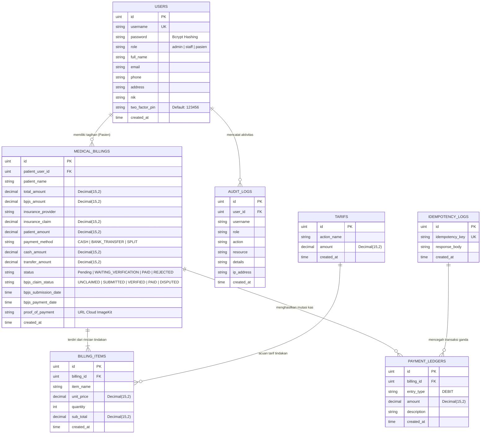
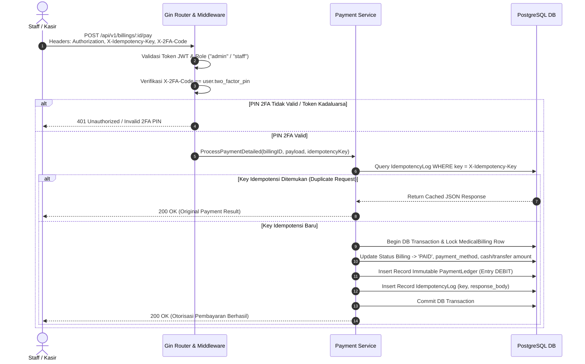
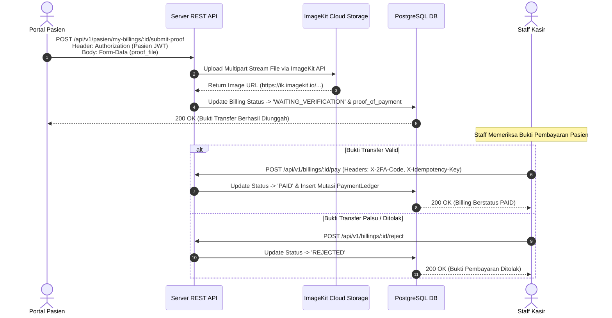
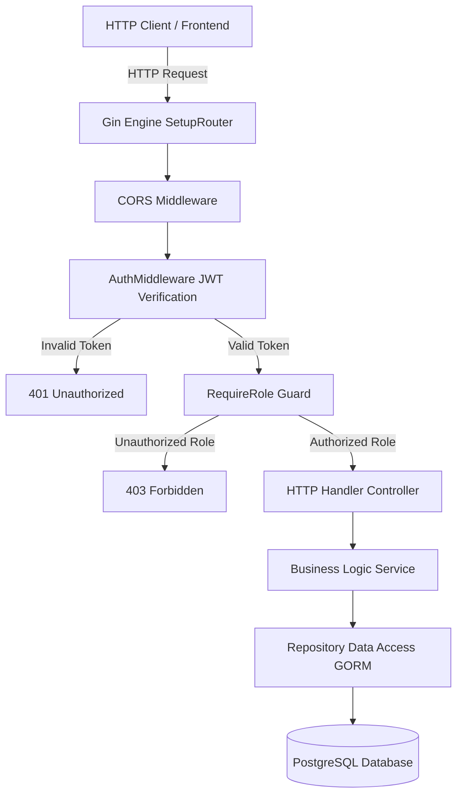

# SIMRS Billing Backend REST API Documentation 🏥💳

Backend REST API untuk **Sistem Informasi Manajemen Rumah Sakit (SIMRS) - Modul Billing, Otorisasi Kasir, Verifikasi Klaim Penjamin, & Analytics Keuangan Medis**. 

Built with **Go (Golang)**, **Gin Web Framework**, **GORM ORM**, **PostgreSQL**, **ImageKit Cloud Storage**, **Excelize v2**, dan **Decimal Math Precision**.

---

## 📋 Daftar Isi

- [🚀 Fitur Utama](#-fitur-utama)
- [🛠️ Teknologi & Pustaka](#-teknologi--pustaka)
- [📂 Struktur Proyek (Layered Architecture)](#-struktur-proyek-layered-architecture)
- [📐 Diagram Arsitektur & ERD](#-diagram-arsitektur--erd)
  - [1. Diagram Relasi Entitas Database (ERD)](#1-diagram-relasi-entitas-database-erd)
  - [2. Sequence Diagram: Otorisasi Pembayaran Kasir 2FA & Idempotensi](#2-sequence-diagram-otorisasi-pembayaran-kasir-2fa--idempotensi)
  - [3. Sequence Diagram: Alur Bukti Bayar Pasien & ImageKit Cloud](#3-sequence-diagram-alur-bukti-bayar-pasien--imagekit-cloud)
  - [4. Flowchart: Middleware Role Guard & Layered Architecture Data Flow](#4-flowchart-middleware-role-guard--layered-architecture-data-flow)
- [⚡ Panduan Instalasi & Memulai](#-panduan-instalasi--memulai)
- [🌱 Seeding Database Data Awal](#-seeding-database-data-awal)
- [📚 Dokumentasi Lengkap API Endpoint](#-dokumentasi-lengkap-api-endpoint)
  - [1. Autentikasi Pengguna (Public)](#1-autentikasi-pengguna-public)
  - [2. Profil Pengguna (Privat - All Roles)](#2-profil-pengguna-privat---all-roles)
  - [3. Master Data Tarif Layanan Medis (Staff / Admin)](#3-master-data-tarif-layanan-medis-staff--admin)
  - [4. Transaksi Tagihan Medis / Billing (Staff / Admin)](#4-transaksi-tagihan-medis--billing-staff--admin)
  - [5. Manajemen Klaim BPJS & Asuransi Swasta (Staff / Admin)](#5-manajemen-klaim-bpjs--asuransi-swasta-staff--admin)
  - [6. Manajemen Pengguna / User Management (Staff / Admin)](#6-manajemen-pengguna--user-management-staff--admin)
  - [7. Jurnal Kas & Mutasi Pembayaran (Staff / Admin / Admin Delete)](#7-jurnal-kas--mutasi-pembayaran-staff--admin--admin-delete)
  - [8. Analytics & Ekspor Laporan Keuangan (Staff / Admin)](#8-analytics--ekspor-laporan-keuangan-staff--admin)
  - [9. Audit Trail System (Staff / Admin)](#9-audit-trail-system-staff--admin)
  - [10. Portal Mandiri Pasien (Pasien Only)](#10-portal-mandiri-pasien-pasien-only)
- [🛡️ Idempotensi & Arsitektur Keamanan](#-idempotensi--arsitektur-keamanan)

---

## 🚀 Fitur Utama

1. **Role-Based Access Control (RBAC)**:
   - Autentikasi JWT terpusat dengan 3 hirarki hak akses: `admin`, `staff`, dan `pasien`.
   - Middleware otorisasi dinamis `RequireRole()` yang melindungi akses endpoint privat.

2. **Kalkulasi Presisi Tinggi (Decimal Math Precision)**:
   - Menggunakan pustaka `github.com/shopspring/decimal` (bukan floating point biasa) untuk seluruh operasi keuangan (Total Bruto, Claim BPJS/Swasta, Beban Netto Pasien, Cash/Transfer Amount) guna menjamin tidak adanya *rounding error*.

3. **Pembayaran Idempoten (*Idempotent Payment Protection*)**:
   - Proteksi transaksi ganda (*double spending / double charge*) menggunakan header HTTP `X-Idempotency-Key`.
   - Kunci idempotensi dicatat pada database PostgreSQL (`idempotency_logs`) untuk mengembalikan response konstan pada request duplikat.

4. **Otorisasi Kasir 2-Factor Authentication (2FA PIN)**:
   - Verifikasi PIN 6-digit keamanan kasir/staff via header `X-2FA-Code` pada setiap transaksi otorisasi bayar (`/billings/:id/pay`).

5. **Verifikasi Bukti Transfer & Integration Cloud Storage ImageKit**:
   - Pasien dapat mengunggah gambar/struk bukti transfer bank yang otomatis diproses via multipart HTTP request dan disimpan ke cloud storage ImageKit API.
   - Mengubah status tagihan menjadi `WAITING_VERIFICATION` untuk kemudian disetujui (`pay`) atau ditolak (`reject`) oleh staff kasir.

6. **Dukungan Pembayaran Multimode**:
   - Mendukung metode pembayaran `CASH`, `BANK_TRANSFER`, maupun `SPLIT` (kombinasi tunai dan transfer).

7. **Manajemen Klaim Penjamin Terpisah (BPJS & Swasta)**:
   - Pemisahan dan filter terintegrasi untuk piutang **BPJS Kesehatan (V-Claim)** dan **Asuransi Swasta** (AXA, Prudential, Allianz, Manulife, FWD, dll.).
   - Pelacakan status klaim: `UNCLAIMED` ➔ `SUBMITTED` ➔ `VERIFIED` ➔ `PAID` / `DISPUTED`.

8. **Ekspor Laporan Keuangan Multi-Format**:
   - Generator laporan keuangan otomatis yang menghasilkan berkas spreadsheet Excel (`.xlsx`) via `excelize/v2` dan berkas CSV bersertifikasi UTF-8 BOM (`\uFEFF`) agar terbaca sempurna di Microsoft Excel.

9. **Jurnal Mutasi Kas (*Immutable Payment Ledger*) & Audit Trail**:
   - Pencatatan jurnal mutasi kas masuk secara permanen (*entry debit ledger*) setiap kali pembayaran disetujui.
   - Rekam jejak audit keamanan (*Audit Log System*) yang mencatat `IP Address`, `User Agent`, `User ID`, `Role`, `Action`, dan `Resource`.

10. **Smart Patient Auto-fill & Dynamic Pagination**:
    - Pencarian akun pasien mengutamakan Nama Lengkap (`full_name`) sebelum jatuh kembali ke `username`.
    - Dilengkapi helper kalkulasi pagination dinamis (`page`, `limit`, `total_rows`, `total_pages`).

---

## 🛠️ Teknologi & Pustaka

* **Bahasa Pemrograman**: Go (Golang) v1.26+
* **Web Framework**: [Gin Gonic](https://github.com/gin-gonic/gin) (`github.com/gin-gonic/gin`)
* **ORM (Object-Relational Mapping)**: [GORM PostgreSQL Driver](https://gorm.io/gorm) (`gorm.io/driver/postgres`)
* **Database Engine**: PostgreSQL
* **Autentikasi & Keamanan**:
  - JWT Signing & Verification: `github.com/golang-jwt/jwt/v5`
  - Bcrypt Password Hashing: `golang.org/x/crypto/bcrypt`
* **Pustaka Matematika Keuangan**: `github.com/shopspring/decimal`
* **Cloud Storage Integration**: ImageKit REST API via Multipart Form HTTP client (`net/http`)
* **Ekspor File Spreadsheet**: `github.com/xuri/excelize/v2`

---

## 📂 Struktur Proyek (Layered Architecture)

Proyek ini menerapkan **Clean Layered Architecture** dengan pemisahan tanggung jawab (*Separation of Concerns*) yang ketat:

```text
server/
├── cmd/
│   └── seed/
│       └── main.go          # CLI Runner independen untuk seeding database
├── config/
│   └── db.go                # Inisialisasi koneksi GORM PostgreSQL & AutoMigrate
├── handlers/                # Presentation Layer (HTTP Request Parsing & Response Formatting)
│   ├── analytics_handler.go # Handler summary keuangan & export Excel/CSV
│   ├── audit_handler.go     # Handler penelusuran audit logs
│   ├── auth_handler.go      # Handler autentikasi (Register & Login JWT)
│   ├── billing_handler.go   # Handler Billing, Pay Authorization, Reject, & Submit Proof
│   ├── claim_handler.go     # Handler Klaim BPJS & Asuransi Swasta
│   ├── ledger_handler.go    # Handler Jurnal Mutasi Kas Pembayaran
│   ├── tarif_handler.go     # Handler Master Data Tarif Layanan Medis
│   └── user_handler.go      # Handler Pengguna & User Profile
├── middleware/              # Cross-Cutting Concerns
│   └── auth.go              # Verification JWT Token & Role Guard (RequireRole)
├── models/                  # Data Layer (GORM Structs & DB Schemas)
│   ├── audit_log.go         # Model Log Rekam Jejak Aktivitas User
│   ├── billing_item.go      # Model Detail Item Tindakan Tagihan
│   ├── idempotency_log.go   # Model Kunci Idempotensi & Response Cache
│   ├── medical_billing.go   # Model Utama Tagihan SIMRS
│   ├── payment_ledger.go    # Model Jurnal Mutasi Kas Masuk
│   ├── tarif.go             # Model Master Tarif Layanan Medis
│   └── user.go              # Model Pengguna, Role, & Security PIN 2FA
├── repository/              # Persistence Layer (Database Access & Queries GORM)
│   ├── audit_repository.go
│   ├── billing_repository.go
│   ├── claim_repository.go
│   ├── ledger_repository.go
│   ├── tarif_repository.go
│   └── user_repository.go
├── route/
│   └── route.go             # Router Central, CORS Settings, & Grouping Endpoint
├── seeders/
│   └── seeder.go            # Database Seeder Data Awal User & Tarif Medis
├── services/                # Business Logic Layer (Core Application Rules)
│   ├── analytics_service.go # Logic Analytics Summary & Excel/CSV Generator
│   ├── audit_service.go     # Logic Recording & Querying Audit Trail
│   ├── billing_service.go   # Logic Business CRUD Billing & Net Calculation
│   ├── claim_service.go     # Logic Tracking Status Claim BPJS & Swasta
│   ├── imagekit_service.go  # Logic Upload File Multipart ke ImageKit Cloud
│   ├── ledger_service.go    # Logic Record Ledger & Mutasi Pembayaran
│   ├── payment_service.go   # Logic Payment Authorization, 2FA PIN, & Idempotency
│   ├── tarif_service.go     # Logic Business Master Tarif
│   └── user_service.go      # Logic Authentication & User Management
├── utils/                   # Infrastructure Helpers
│   ├── jwt.go               # Token Generation & Claims Parser
│   ├── pagination.go        # Pagination & Dynamic Search Calculator
│   └── password.go          # Password Hashing & Verification
├── .env                     # File Variabel Lingkungan Environment
├── go.mod                   # Dependencies Manager Go
└── main.go                  # Entry Point Server & Flag Parser (-seed)
```

---

## 📐 Diagram Arsitektur & ERD

### 1. Diagram Relasi Entitas Database (ERD)



---

### 2. Sequence Diagram: Otorisasi Pembayaran Kasir 2FA & Idempotensi



---

### 3. Sequence Diagram: Alur Bukti Bayar Pasien & ImageKit Cloud



---

### 4. Flowchart: Middleware Role Guard & Layered Architecture Data Flow



---

## ⚡ Panduan Instalasi & Memulai

### 1. Prasyarat Sistem
* **Go (Golang)** versi 1.26+
* **PostgreSQL Server** (Port default: `5432`)
* **Git** & **API Client** (Postman, Insomnia, atau cURL)

### 2. Konfigurasi Environment (`.env`)
Buat file bernama `.env` di dalam folder `server/`:

```env
PORT=8080
DB_HOST=localhost
DB_USER=postgres
DB_PASSWORD=postgres
DB_NAME=simrs_billing
DB_PORT=5432
JWT_SECRET=supersecretkey_simrs_2026

IMAGEKIT_PUBLIC_KEY="public_ngqO64a5ePG5VSG9dVZPnsbVG9k="
IMAGEKIT_URL_ENDPOINT="https://ik.imagekit.io/luyrswpql"
IMAGEKIT_PRIVATE_KEY="private_gfPQyiB0l8vfVEQypYp5QYPpyJ4="
```

### 3. Install Dependensi Go
```bash
go mod download
```

### 4. Jalankan HTTP Server
```bash
go run main.go
```
Server REST API akan berjalan di `http://localhost:8080`.

---

## 🌱 Seeding Database Data Awal

Untuk membuat skema tabel PostgreSQL dan mengisi data seeder awal (*Akun User default dan Katalog Master Tarif Medis*):

### Cara 1: Menjalankan Server dengan Flag `-seed`
```bash
go run main.go -seed
```

### Cara 2: Menjalankan CLI Seeder Terpisah
```bash
go run cmd/seed/main.go
```

### Kredensial Default Hasil Seeding:

| Role Pengguna | Username | Password | PIN 2FA | Hak Akses |
| :--- | :--- | :--- | :--- | :--- |
| **Admin** | `admin` | `password123` | `123456` | Penuh (All Modules, User Management, Delete Mutasi Kas) |
| **Staff Kasir** | `staff` | `password123` | `123456` | Billings, Otorisasi Bayar, Claims, Master Tarif, Analytics, Audit Log |
| **Pasien 1** | `pasien1` | `password123` | — | Portal Pasien (Tagihan Saya, Upload Bukti Transfer) |
| **Pasien 2** | `pasien2` | `password123` | — | Portal Pasien (Tagihan Saya, Upload Bukti Transfer) |

---

## 📚 Dokumentasi Lengkap API Endpoint

Base URL: `http://localhost:8080/api/v1`

---

### 1. Autentikasi Pengguna (Public)

#### A. Pendaftaran Pengguna Baru
* **Endpoint**: `POST /auth/register`
* **Request Body**:
  ```json
  {
    "username": "pasien3",
    "password": "password123",
    "role": "pasien",
    "full_name": "Siti Rahmawati",
    "email": "siti@example.com",
    "phone": "081298765432",
    "nik": "3171019876540002"
  }
  ```
* **Response (201 Created)**:
  ```json
  {
    "message": "Registrasi Berhasil",
    "role": "pasien"
  }
  ```

#### B. Login & Perolehan JWT Token
* **Endpoint**: `POST /auth/login`
* **Request Body**:
  ```json
  {
    "username": "staff",
    "password": "password123"
  }
  ```
* **Response (200 OK)**:
  ```json
  {
    "message": "Login Berhasil",
    "role": "staff",
    "token": "eyJhbGciOiJIUzI1NiIsInR5cCI6IkpXVCJ9..."
  }
  ```

---

### 2. Profil Pengguna (Privat - All Roles)
> **Header Wajib**: `Authorization: Bearer <token_jwt>`

#### A. Ambil Data Profil Saya
* **Endpoint**: `GET /profile`
* **Response (200 OK)**:
  ```json
  {
    "data": {
      "id": 2,
      "username": "staff",
      "role": "staff",
      "full_name": "Kasir Utama SIMRS",
      "email": "staff@simrs.id",
      "phone": "081122334455",
      "two_factor_pin": "123456"
    }
  }
  ```

#### B. Update Profil & PIN 2FA Security
* **Endpoint**: `PUT /profile`
* **Request Body**:
  ```json
  {
    "full_name": "Kasir Senior SIMRS",
    "email": "kasir.senior@simrs.id",
    "two_factor_pin": "654321"
  }
  ```

---

### 3. Master Data Tarif Layanan Medis (Staff / Admin)
> **Header Wajib**: `Authorization: Bearer <token_staff_atau_admin>`

| Method | Endpoint | Query Parameter | Deskripsi |
| :--- | :--- | :--- | :--- |
| `POST` | `/tarifs` | — | Tambah tarif layanan baru |
| `GET` | `/tarifs` | `page=1&limit=10&search=Dokter` | Get list tarif (Paginated & Search) |
| `GET` | `/tarifs/:id` | — | Detail tarif by ID |
| `PUT` | `/tarifs/:id` | — | Update nama / nominal tarif |
| `DELETE` | `/tarifs/:id` | — | Hapus tarif layanan |

##### Contoh Request `POST /tarifs`:
```json
{
  "action_name": "Pemeriksaan CT Scan Thorax",
  "amount": 1250000
}
```

---

### 4. Transaksi Tagihan Medis / Billing (Staff / Admin)
> **Header Wajib**: `Authorization: Bearer <token_staff_atau_admin>`

| Method | Endpoint | Query Parameter | Deskripsi |
| :--- | :--- | :--- | :--- |
| `POST` | `/billings` | — | Terbitkan tagihan medis baru pasien |
| `GET` | `/billings` | `page=1&limit=10&search=Budi&status=Pending` | Get list seluruh billing pasien |
| `GET` | `/billings/:id` | — | Detail billing beserta rincian item tindakan |
| `PUT` | `/billings/:id` | — | Update billing (Status / Penjamin) |
| `DELETE` | `/billings/:id` | — | Hapus data billing |
| `POST` | `/billings/:id/pay` | — | Otorisasi pembayaran (Wajib Header `X-Idempotency-Key` & `X-2FA-Code`) |
| `POST` | `/billings/:id/reject` | — | Tolak bukti bayar transfer pasien |
| `POST` | `/billings/:id/submit-proof` | — | Form-Data upload bukti transfer pasien |

##### Contoh Request `POST /billings`:
```json
{
  "patient_user_id": 3,
  "patient_name": "Budi Santoso",
  "insurance_provider": "BPJS Kesehatan",
  "insurance_claim": 150000,
  "items": [
    {
      "tarif_id": 1,
      "quantity": 1
    },
    {
      "action_name": "Obat Resep Standar",
      "unit_price": 75000,
      "quantity": 2
    }
  ]
}
```

##### Contoh Request `POST /billings/:id/pay` (Otorisasi Pembayaran Kasir):
* **Headers**:
  - `Authorization: Bearer <token_staff>`
  - `X-Idempotency-Key: PAY-BILL-101-20260814`
  - `X-2FA-Code: 123456`
* **Request Body**:
  ```json
  {
    "payment_method": "CASH",
    "cash_amount": 150000,
    "transfer_amount": 0
  }
  ```
* **Response (200 OK)**:
  ```json
  {
    "message": "Otorisasi pembayaran berhasil diproses",
    "data": {
      "id": 101,
      "patient_name": "Budi Santoso",
      "total_amount": "300000",
      "insurance_claim": "150000",
      "patient_amount": "150000",
      "status": "PAID"
    }
  }
  ```

---

### 5. Manajemen Klaim BPJS & Asuransi Swasta (Staff / Admin)
> **Header Wajib**: `Authorization: Bearer <token_staff_atau_admin>`

| Method | Endpoint | Query Parameter | Deskripsi |
| :--- | :--- | :--- | :--- |
| `GET` | `/claims` | `page=1&limit=10&status=UNCLAIMED&provider_type=bpjs` | List klaim (`provider_type`: `bpjs` / `swasta` / `all`) |
| `GET` | `/claims/summary` | `provider_type=bpjs` | Ringkasan KPI klaim (Unclaimed, Submitted, Verified, Paid, Disputed) |
| `PUT` | `/claims/:id/status` | — | Update status pengajuan klaim penjamin |

##### Contoh Request `PUT /claims/:id/status`:
```json
{
  "status": "VERIFIED"
}
```

---

### 6. Manajemen Pengguna / User Management (Staff / Admin)
> **Header Wajib**: `Authorization: Bearer <token_staff_atau_admin>`

| Method | Endpoint | Query Parameter | Deskripsi |
| :--- | :--- | :--- | :--- |
| `POST` | `/users` | — | Tambah pengguna baru |
| `GET` | `/users` | `page=1&limit=10&search=kasir&role=staff` | List pengguna |
| `GET` | `/users/:id` | — | Detail pengguna by ID |
| `PUT` | `/users/:id` | — | Update data pengguna / role |
| `DELETE` | `/users/:id` | — | Hapus akun pengguna |

---

### 7. Jurnal Kas & Mutasi Pembayaran (Staff / Admin / Admin Delete)
> **Header Wajib**: `Authorization: Bearer <token_jwt>`

| Method | Endpoint | Query Parameter | Role | Deskripsi |
| :--- | :--- | :--- | :--- | :--- |
| `GET` | `/ledgers` | `page=1&limit=10&search=Pembayaran` | Staff / Admin | List mutasi kas masuk (*immutable payment journal*) |
| `GET` | `/ledgers/:id` | — | Staff / Admin | Detail mutasi kas by ID |
| `DELETE` | `/ledgers/:id` | — | **Admin Only** | Hapus entri mutasi kas |

---

### 8. Analytics & Ekspor Laporan Keuangan (Staff / Admin)
> **Header Wajib**: `Authorization: Bearer <token_staff_atau_admin>`

#### A. Ringkasan Executive Financial & Analytics Summary
* **Endpoint**: `GET /analytics/summary`
* **Query Params**: `year=2026&month=8`
* **Response (200 OK)**:
  ```json
  {
    "data": {
      "total_revenue": "45250000.00",
      "total_bpjs_claim": "18400000.00",
      "total_private_insurance_claim": "12100000.00",
      "total_patient_paid": "14750000.00",
      "pending_billings_count": 12,
      "paid_billings_count": 84,
      "claims_status_breakdown": {
        "unclaimed": 5,
        "submitted": 10,
        "verified": 45,
        "paid": 24
      }
    }
  }
  ```

#### B. Unduh Laporan Keuangan (Excel / CSV)
* **Endpoint**: `GET /analytics/export`
* **Query Params**: `format=xlsx` (atau `format=csv`), `year=2026`, `month=8`, `token=<jwt>`
* **Response**: Binary File Download (`Content-Disposition: attachment; filename=Laporan_Kas_SIMRS_2026_08.xlsx`)

---

### 9. Audit Trail System (Staff / Admin)
> **Header Wajib**: `Authorization: Bearer <token_staff_atau_admin>`

* **Endpoint**: `GET /audit-logs`
* **Query Params**: `page=1&limit=10&search=PAY_BILLING`
* **Response (200 OK)**:
  ```json
  {
    "data": [
      {
        "id": 1,
        "user_id": 2,
        "username": "staff",
        "role": "staff",
        "action": "PAY_BILLING",
        "resource": "/billings/101/pay",
        "details": "Otorisasi Pembayaran Tagihan #101 sebesar Rp 150.000",
        "ip_address": "127.0.0.1",
        "created_at": "2026-08-14T10:00:00Z"
      }
    ],
    "meta": {
      "page": 1,
      "limit": 10,
      "total_rows": 1,
      "total_pages": 1
    }
  }
  ```

---

### 10. Portal Mandiri Pasien (Pasien Only)
> **Header Wajib**: `Authorization: Bearer <token_pasien>`

| Method | Endpoint | Query Parameter | Deskripsi |
| :--- | :--- | :--- | :--- |
| `GET` | `/pasien/my-billings` | `page=1&limit=10&search=USG` | List tagihan medis milik akun pasien yang login |
| `GET` | `/pasien/my-billings/:id` | — | Detail tagihan medis milik pasien |
| `POST` | `/pasien/my-billings/:id/submit-proof` | — | Form-Data upload bukti transfer bank ke ImageKit |

---

## 🛡️ Idempotensi & Arsitektur Keamanan

Dalam transaksi keuangan medis rumah sakit, integritas data dan proteksi keamanan sangat kritikal:

1. **Proteksi Idempotensi (`X-Idempotency-Key`)**:
   * Header `X-Idempotency-Key` diperiksa ke tabel database `idempotency_logs`.
   * Jika request dengan key yang sama terdeteksi, sistem tidak akan melakukan pemrosesan ulang atau mendebit kas secara ganda, melainkan langsung mengembalikan response pertama yang tersimpan.

2. **Otorisasi Kasir 2FA Security PIN**:
   * Header `X-2FA-Code` memverifikasi 6-digit PIN keamanan kasir/staff (`two_factor_pin`).
   * Transaksi otorisasi bayar akan digagalkan jika PIN tidak sesuai.

3. **Decimal Precision**:
   * Seluruh kolom nominal di-cast menggunakan `decimal.Decimal` (Precision 15, Scale 2) pada PostgreSQL untuk menghindari masalah pembulatan *floating-point*.

4. **Audit Trail System**:
   * Log rekam jejak mencatat alamat IP, agen browser, timestamp, serta rincian tindakan pengguna untuk mempermudah investigasi dan kepatuhan audit.
